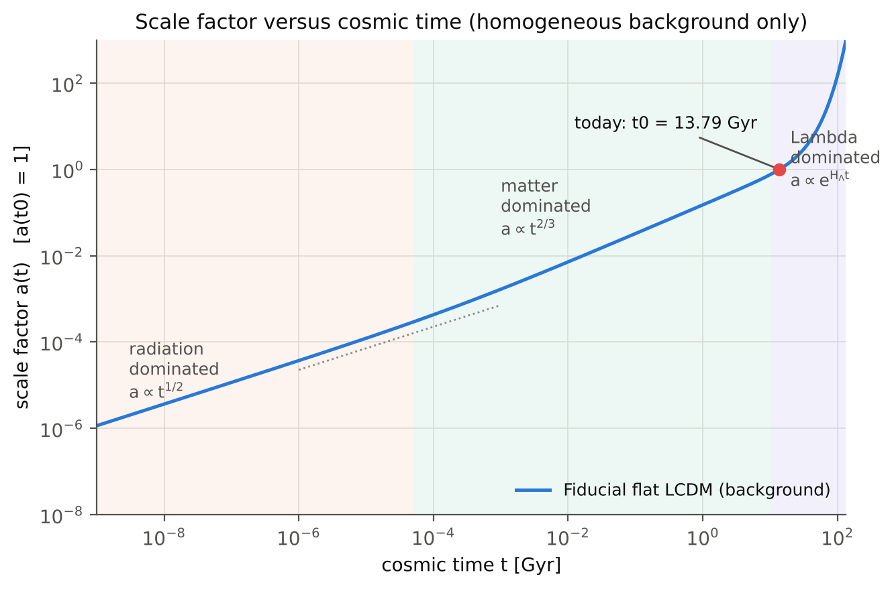
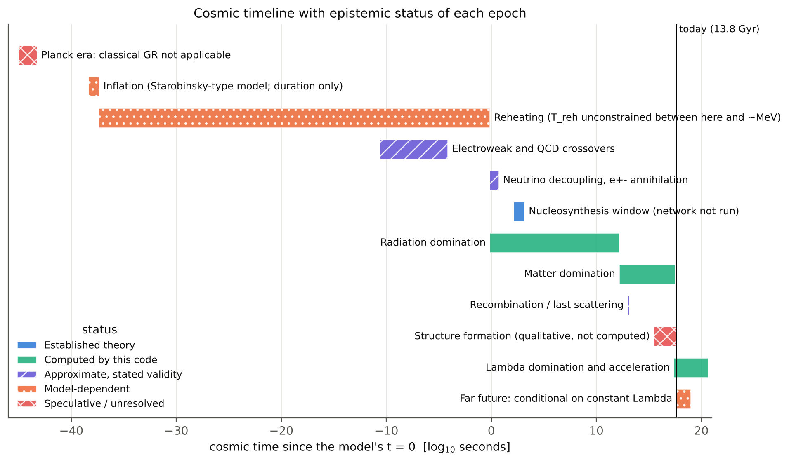
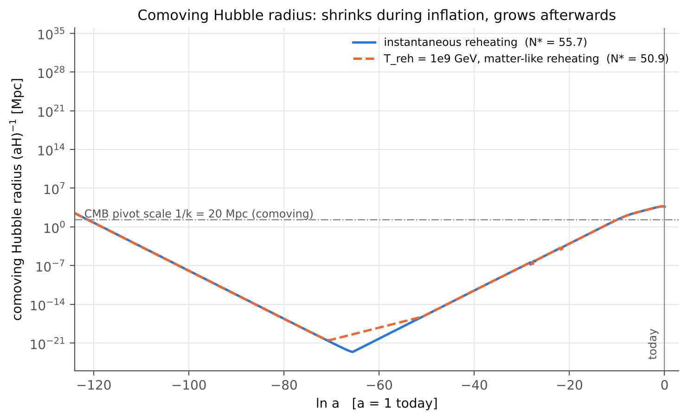
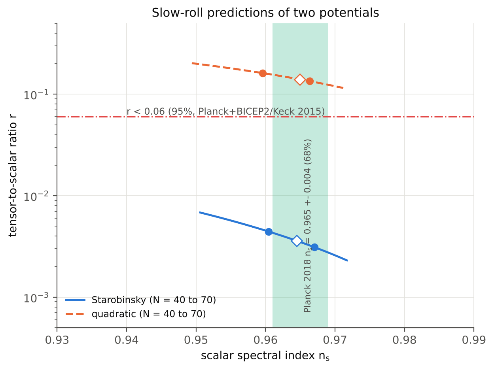
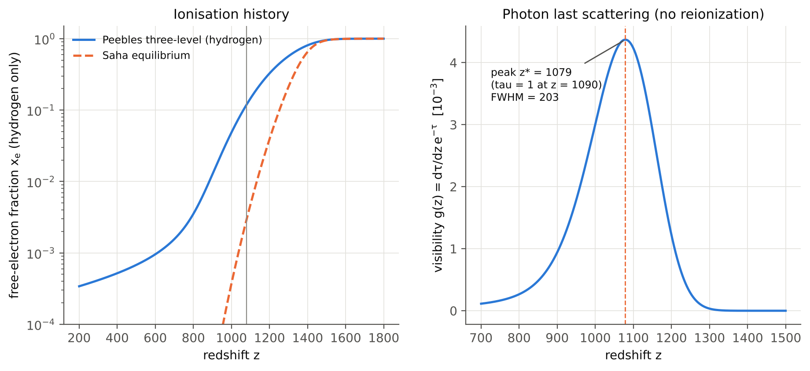
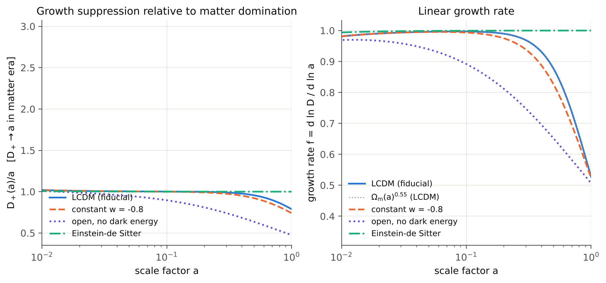
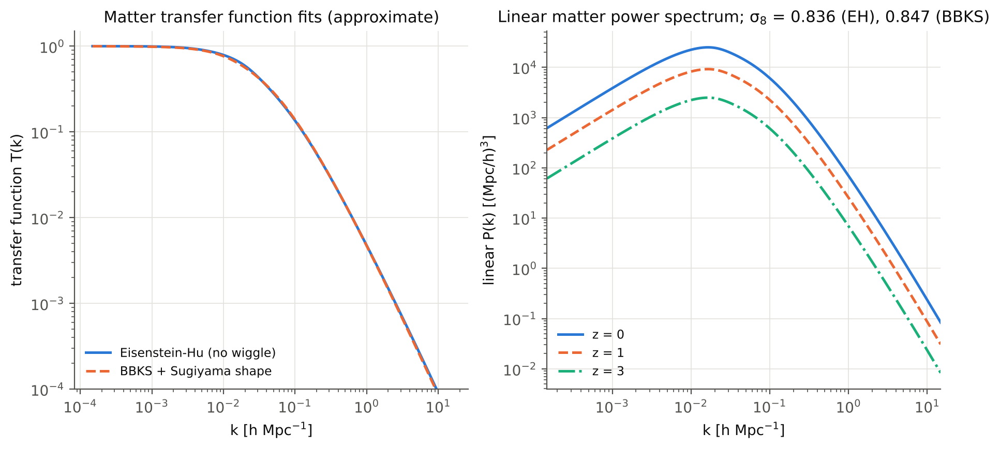
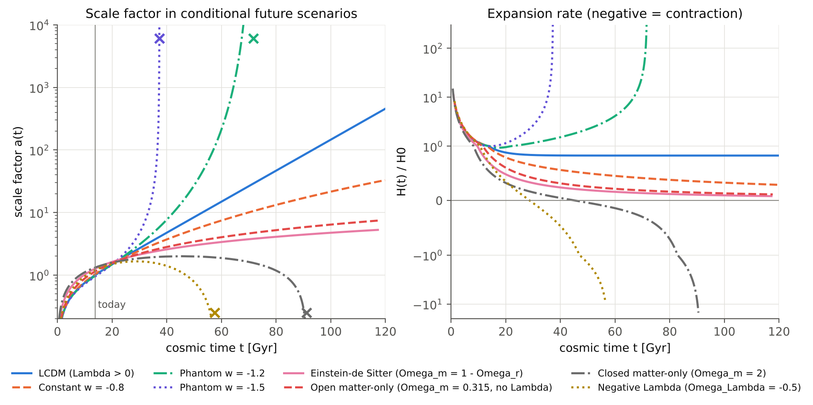

<h1 align="center">Cosmic Spacetime Evolution</h1>

<p align="center">
A computational investigation of the universe from its earliest physical regimes to its possible cosmic end states
</p>

<p align="center">
  
  
  <a href="https://github.com/[OWNER]/[REPOSITORY]/actions/workflows/tests.yml"></a>
  <a href="https://github.com/[OWNER]/[REPOSITORY]/actions/workflows/reproducibility.yml"></a>
  
  
</p>

> **Status note.** The two workflow badges above are placeholders: `[OWNER]` and `[REPOSITORY]` must be replaced after the repository is published, and they will show a result only after the workflows in `.github/workflows/` have actually run on GitHub. At the time of packaging, tests and validation were executed locally (113 unit tests and 13 numerical validation checks passed); no hosted continuous-integration run has taken place.

## Contents

1. [Research motivation](#1-research-motivation)
2. [Scientific questions](#2-scientific-questions)
3. [Main implemented capabilities](#3-main-implemented-capabilities)
4. [Important scientific limitations](#4-important-scientific-limitations)
5. [Key equations](#5-key-equations)
6. [Selected figures](#6-selected-figures)
7. [Repository structure](#7-repository-structure)
8. [Installation and environment setup](#8-installation-and-environment-setup)
9. [Running the model](#9-running-the-model)
10. [Generating figures and datasets](#10-generating-figures-and-datasets)
11. [Testing](#11-testing)
12. [Numerical methods and validation](#12-numerical-methods-and-validation)
13. [Parameter provenance](#13-parameter-provenance)
14. [References and citation guidance](#14-references-and-citation-guidance)
15. [Research extensions](#15-research-extensions)
16. [License and contribution guidance](#16-license-and-contribution-guidance)

## 1. Research motivation

The history of the universe spans more than sixty orders of magnitude in energy, from the Planck scale to the cosmic microwave background and the present dark-energy-dominated epoch. Each regime is described by a different effective theory, with different levels of observational support. Textbook treatments present these regimes separately; this repository assembles them in one reproducible, configuration-driven codebase in which every quantity is tied to an explicit equation, a stated approximation, and a label stating how much confidence it deserves.

The aim is not to claim a complete first-principles derivation of cosmic history. No such derivation exists. The aim is to provide a transparent computational laboratory in which the established background expansion, the model-dependent early-universe physics and the conditional far-future scenarios can be computed, validated against exact limits, and compared.

## 2. Scientific questions

1. How do the age, distances and horizons of the universe follow from the Friedmann equations for a given matter, radiation, curvature and dark-energy content?
2. How do the cosmic epochs (radiation, matter and dark-energy domination) and the acceleration onset depend on the parameters?
3. What does a slow-roll inflationary phase imply for the horizon problem and for the scalar and tensor spectra, for explicitly stated potentials and reheating assumptions?
4. How does the thermal history, through the relativistic degrees of freedom, connect the earliest radiation era to recombination?
5. How does linear matter growth, together with a transfer function, set the amplitude of linear structure ($\sigma_8$) and the halo abundance?
6. Which future scenarios (eternal expansion, big rip, recollapse) arise, conditionally, from different assumptions about dark energy and curvature?

## 3. Main implemented capabilities

Each item is labelled with the category defined in [docs/PHYSICS.md](docs/PHYSICS.md): **E** established, **N** numerical, **A** approximate, **M** model dependent, **S** speculative.

| Capability | Module | Label | Status |
|---|---|:---:|---|
| FLRW background, CPL dark energy, curvature, radiation | `background/` | N | implemented, validated against exact limits |
| Distances, horizons, curvature geometry | `geometry/` | N | implemented, validated |
| Thermal history, $g_*(T)$, entropy | `early_universe/thermal_history.py` | A | implemented (step approximation) |
| Slow-roll inflation (quadratic, Starobinsky), pivot e-folds | `early_universe/inflation.py` | M | implemented |
| Perturbative reheating (fluid toy model) | `early_universe/reheating.py` | M | implemented |
| Peebles recombination, visibility, sound horizon | `early_universe/recombination.py` | A | implemented (0.63 percent offset in $\theta_*$) |
| BBN relations and backend hook | `early_universe/bbn_interface.py` | E | **abundances not computed** |
| Scalar and tensor primordial modes | `perturbations/` | M | implemented |
| Linear growth factor | `perturbations/growth_factor.py` | A | implemented |
| Transfer functions, $P(k)$, $\sigma_8$, halo mass functions | `structure/` | A | implemented (fitting formulae) |
| Conditional future scenarios and fate classification | `future/` | M | implemented |
| Convergence and uncertainty tools | `numerics/` | N | implemented |
| Quantum cosmology, Planck regime | n/a | S | **not implemented** (see [docs/QUANTUM_COSMOLOGY.md](docs/QUANTUM_COSMOLOGY.md)) |
| Boltzmann (CMB) solver, N-body, BBN network | n/a | n/a | **not implemented** (see roadmap) |

## 4. Important scientific limitations

* The homogeneous background solver does not predict CMB anisotropies, galaxies, halos or nonlinear structure. Where those topics appear, they rest on explicit linear or phenomenological models and are labelled as such.
* **Big Bang nucleosynthesis is not computed.** No nuclear reaction network is included. Only textbook relations with an input neutron fraction are provided.
* Classical general relativity is not extrapolated into the Planck regime; no quantum-gravity model is implemented.
* Inflation results hold for two stated potentials with a constant-rate reheating model. The quadratic potential reproduces its known conflict with the tensor-to-scalar bound ($r\approx0.14$).
* Neutrinos are treated as massless radiation. Transfer functions and the recombination coefficient are fitting formulae whose coefficients were recalled from the literature and not re-verified against the source papers (see [docs/REFERENCES.md](docs/REFERENCES.md)).
* Known discrepancies with Planck 2018 values: $\sigma_8=0.836$ against $0.811\pm0.006$ (about 3 percent high); $100\theta_*=1.0475$ against $1.0409\pm0.0003$.
* Future scenarios are conditional on the assumed dark-energy model. The code does not determine the true fate of the universe.

## 5. Key equations

Friedmann equation (flat or curved, with CPL dark energy $w(a)=w_0+w_a(1-a)$):

$$
H^2(a)=H_0^2\left[\Omega_r a^{-4}+\Omega_m a^{-3}+\Omega_k a^{-2}+\Omega_{\mathrm{DE}}\,a^{-3(1+w_0+w_a)}e^{-3w_a(1-a)}\right]
$$

Regularised form used in all quadratures, $Q(a)=a^4E^2(a)$, which stays finite as $a\to0$:

$$
H_0 t(a)=\int_0^a\frac{a'\,da'}{\sqrt{Q(a')}},\qquad
D_C=\frac{c}{H_0}\int_a^1\frac{da'}{\sqrt{Q(a')}}
$$

Deceleration parameter:

$$
q=-\frac{a\ddot a}{\dot a^2}=\frac12\sum_i\Omega_i(a)\bigl(1+3w_i(a)\bigr)
$$

Inflation in e-fold time ($M_P=1$, $\epsilon_H=\tfrac12\phi'^2$) and the Mukhanov-Sasaki equation:

$$
\phi''=-(3-\epsilon_H)\left(\phi'+\frac{V_{,\phi}}{V}\right),\qquad
\mathcal R''+(3-\epsilon_H+\eta_H)\mathcal R'+\left(\frac{k}{aH}\right)^2\mathcal R=0
$$

Linear growth and the matter power spectrum:

$$
D''+(1-q)D'-\tfrac32\Omega_m(a)D=0,\qquad
\Delta_m^2(k,a)=\frac{4}{25}\left(\frac{k^2}{\Omega_mH_0^2}\right)^2D_+^2(a)\,T^2(k)\,\Delta^2_{\mathcal R}(k)
$$

Complete derivations are in [docs/MATHEMATICAL_DERIVATIONS.md](docs/MATHEMATICAL_DERIVATIONS.md).

### Key numerical results (fiducial parameters)

Produced by `scripts/compute_key_results.py` ([results/tables/key_results.csv](results/tables/key_results.csv)). The Status column uses the five categories.

| Quantity | Value | Unit | Status | Method |
|---|---:|---|---|---|
| Age of the universe t0 | 13.7907 | Gyr | numerical | exact quadrature of the Friedmann equation |
| Hubble time 1/H0 | 14.5073 | Gyr | numerical | unit conversion |
| Omega_r (photons + massless neutrinos) | 9.20961e-05 |  | numerical | Stefan-Boltzmann with N_eff |
| Matter-radiation equality z_eq | 3419.34 |  | numerical | Omega_r a^-4 = Omega_m a^-3 (massless-nu approximation) |
| Onset of acceleration z_acc (q = 0) | 0.631721 |  | numerical | root of q(a) |
| Cosmic time at onset of acceleration | 7.69318 | Gyr | numerical | t(a_acc) |
| Comoving particle horizon today | 14.1444 | Gpc | numerical | int_0^1 da/sqrt(Q) |
| Comoving event horizon today | 5.11391 | Gpc | numerical | int_1^inf da/sqrt(Q) |
| Comoving distance to z = 1100 | 13.8662 | Gpc | numerical | quadrature |
| Angular-diameter distance to z = 1100 | 12.5942 | Mpc | numerical | quadrature |
| Linear growth suppression D+(1) | 0.788107 |  | approximate | linear growth ODE, scale independent |
| sigma_8 (EH no-wiggle, A_s = 2.1e-9) | 0.835693 |  | approximate | fitting-formula transfer function; Planck-quoted 0.811 +- 0.006 |
| Baryon-to-photon ratio eta | 6.12452e-10 |  | numerical | Omega_b h^2 and T_cmb |
| Recombination visibility peak z* | 1078.92 |  | approximate | Peebles three-level hydrogen model |
| Comoving sound horizon at z* | 145.2 | Mpc | approximate | Peebles model + background |
| 100 theta* = 100 r_s/D_M | 1.04746 |  | approximate | Planck 2018 reports 100 theta_MC = 1.0409 +- 0.0003 |
| de Sitter horizon radius c/H_Lambda | 17.5295 | Gly | numerical | asymptotic future (conditional on Lambda) |
| Gibbons-Hawking temperature | 2.19755e-30 | K | established | hbar H_Lambda/(2 pi k_B), pure de Sitter |
| [Starobinsky] N* (instantaneous reheating) | 55.7248 | e-folds | model | self-consistent pivot e-folds |
| [Starobinsky] n_s at N* | 0.964493 |  | model | leading-order slow roll, exact background |
| [Starobinsky] r at N* | 0.00359325 |  | model | 16 eps_V |
| [Starobinsky] H_end | 7.23307e+12 | GeV | model | amplitude fixed by A_s = 2.1e-9 |
| [quadratic] N* (instantaneous reheating) | 57.5374 | e-folds | model | self-consistent pivot e-folds |
| [quadratic] n_s at N* | 0.964909 |  | model | leading-order slow roll, exact background |
| [quadratic] r at N* | 0.140362 |  | model | 16 eps_V |
| [quadratic] H_end | 7.57125e+12 | GeV | model | amplitude fixed by A_s = 2.1e-9 |

## 6. Selected figures

All 23 figures are generated by registered functions in `src/cosmic_evolution/visualization/`, saved as PNG and PDF, and accompanied by a CSV dataset. Eight are shown here; the complete index follows.

<p align="center"></p>

**Scale factor versus cosmic time** (`fig01_scale_factor_vs_time`; category: numerical). Scale factor of the fiducial flat LCDM background from the exact quadrature t(a). Shaded bands mark radiation, matter and cosmological-constant domination (boundaries at a_eq = Om_r/Om_m and a = (Om_m/Om_L)^(1/3)). The far-future branch assumes a cosmological constant persists forever (conditional on the model).

<p align="center"></p>

**Cosmic timeline with model dependence** (`fig06_cosmic_timeline`; category: model). Logarithmic timeline of the universe's epochs. Colour AND hatch encode the epistemic category: established theory; computed by this code; approximate with stated validity; model dependent; speculative. Times of post-inflationary epochs come from the radiation-era t = 1/(2H) relation with the g_* step approximation (about 10% uncertain near thresholds) and from the fiducial background; inflation timing is shown for one illustrative model and its time origin is not physically meaningful; the Planck-era bar spans the regime where classical GR cannot be trusted. Structure-formation epoch is qualitative (starting at z ~ 30 as an indicative marker) and not computed by the background solver.

<p align="center"></p>

**Comoving Hubble radius through cosmic history** (`fig10_comoving_hubble_radius`; category: model). Comoving Hubble radius (aH)^-1 built from the exact Starobinsky-type background during inflation (amplitude fixed by A_s = 2.1e-9 at the pivot), a reheating epoch of equation of state w = 0 with the stated T_reh (or instantaneous reheating), radiation domination with the SM g_*(T) step approximation and entropy conservation, then the matter and Lambda eras of the fiducial background. Scales exit the horizon during inflation (curve decreasing) and re-enter later; the horizon-problem solution corresponds to the 1/k line lying above the curve at early times. T_reh is an input, not a measurement.

<p align="center"></p>

**Inflationary observables in the n_s-r plane** (`fig13_inflation_ns_r`; category: model). Leading-order potential slow-roll predictions n_s = 1 - 6 eps_V + 2 eta_V and r = 16 eps_V evaluated N e-folds before the end of the numerically integrated background. Filled circles: N = 50 and 60; open diamonds: the self-consistent N* for instantaneous reheating. Only the published constraint values (n_s band, r bound) are drawn; no likelihood contours are reproduced. The quadratic model lies above the bound, the Starobinsky-type model below it, subject to the model assumptions.

<p align="center"></p>

**Recombination and last scattering** (`fig16_recombination`; category: approximate). Approximate recombination: Peebles three-level atom with case-B coefficients, Ly-alpha escape and two-photon decay, hydrogen only, no reionization, T_m = T_gamma. The visibility function peaks at z = 1079; the comoving sound horizon at the peak is 145.2 Mpc and 100 theta* = 1.0475, to be compared with the 100 theta_MC = 1.0409 +- 0.0003 reported by Planck 2018; the ~0.6% offset reflects the approximations (helium, fudge factor, radiative transfer). This is NOT a CMB anisotropy calculation.

<p align="center"></p>

**Linear growth factor** (`fig11_linear_growth_factor`; category: approximate). Linear, scale-independent growth of pressureless matter perturbations from the equation D'' + (1-q) D' = (3/2) Om_m(a) D with Meszaros initial conditions. Valid on sub-horizon, linear scales with smooth dark energy; no neutrino free streaming, no modified gravity. This is NOT a nonlinear structure-formation calculation and does not predict galaxies or halos by itself.

<p align="center"></p>

**Transfer function and linear matter power spectrum** (`fig18_matter_power_spectrum`; category: approximate). Left: two analytic fits to the matter transfer function (no baryon acoustic oscillations). Right: linear matter power spectrum built from A_s = 2.1e-9, n_s = 0.965, the Eisenstein-Hu shape and the linear growth factor. Resulting sigma_8 = 0.836 (EH) / 0.847 (BBKS) versus the Planck-reported 0.811 +- 0.006; the few-percent excess reflects the no-wiggle fit, massless-neutrino treatment and fitting-formula errors. Linear regime only; this does not include non-linear evolution or CMB physics.

<p align="center"></p>

**Comparison of conditional future scenarios** (`fig12_future_scenarios`; category: model). Classical future expansion of eight scenarios, each defined by explicit density parameters (see docs/FUTURE_COSMOLOGY.md). Crosses mark finite-time singularities (big rip for w < -1, big crunch for recollapsing models). These are conditional outcomes of assumed models and classical General Relativity, NOT predictions of the actual final state of the universe; vacuum decay, quantum gravity and unknown physics are excluded.


<details>
<summary>Complete figure index (23 figures)</summary>

| Figure | Title | Category | PNG | PDF | Data |
|---|---|---|---|---|---|
| fig01 | Scale factor versus cosmic time | numerical | [png](results/figures/fig01_scale_factor_vs_time.png) | [pdf](results/figures/fig01_scale_factor_vs_time.pdf) | [csv](results/datasets/fig01_scale_factor_vs_time.csv) |
| fig02 | Hubble parameter versus redshift | numerical | [png](results/figures/fig02_hubble_parameter_vs_redshift.png) | [pdf](results/figures/fig02_hubble_parameter_vs_redshift.pdf) | [csv](results/datasets/fig02_hubble_parameter_vs_redshift.csv) |
| fig03 | Density fractions versus scale factor | numerical | [png](results/figures/fig03_density_fractions.png) | [pdf](results/figures/fig03_density_fractions.pdf) | [csv](results/datasets/fig03_density_fractions.csv) |
| fig04 | Deceleration parameter and acceleration transition | numerical | [png](results/figures/fig04_deceleration_parameter.png) | [pdf](results/figures/fig04_deceleration_parameter.pdf) | [csv](results/datasets/fig04_deceleration_parameter.csv) |
| fig05 | Photon temperature scaling | established | [png](results/figures/fig05_photon_temperature_scaling.png) | [pdf](results/figures/fig05_photon_temperature_scaling.pdf) | [csv](results/datasets/fig05_photon_temperature_scaling.csv) |
| fig06 | Cosmic timeline with model dependence | model | [png](results/figures/fig06_cosmic_timeline.png) | [pdf](results/figures/fig06_cosmic_timeline.pdf) | [csv](results/datasets/fig06_cosmic_timeline.csv) |
| fig07 | Comoving distance versus redshift | numerical | [png](results/figures/fig07_comoving_distance.png) | [pdf](results/figures/fig07_comoving_distance.pdf) | [csv](results/datasets/fig07_comoving_distance.csv) |
| fig08 | Luminosity and angular-diameter distances | numerical | [png](results/figures/fig08_luminosity_angular_distance.png) | [pdf](results/figures/fig08_luminosity_angular_distance.pdf) | [csv](results/datasets/fig08_luminosity_angular_distance.csv) |
| fig09 | Inflationary background evolution | model | [png](results/figures/fig09_inflation_background.png) | [pdf](results/figures/fig09_inflation_background.pdf) | [csv](results/datasets/fig09_inflation_background.csv) |
| fig10 | Comoving Hubble radius through cosmic history | model | [png](results/figures/fig10_comoving_hubble_radius.png) | [pdf](results/figures/fig10_comoving_hubble_radius.pdf) | [csv](results/datasets/fig10_comoving_hubble_radius__1.csv) |
| fig11 | Linear growth factor | approximate | [png](results/figures/fig11_linear_growth_factor.png) | [pdf](results/figures/fig11_linear_growth_factor.pdf) | [csv](results/datasets/fig11_linear_growth_factor.csv) |
| fig12 | Comparison of conditional future scenarios | model | [png](results/figures/fig12_future_scenarios.png) | [pdf](results/figures/fig12_future_scenarios.pdf) | [csv](results/datasets/fig12_future_scenarios__1.csv) |
| fig13 | Inflationary observables in the n_s-r plane | model | [png](results/figures/fig13_inflation_ns_r.png) | [pdf](results/figures/fig13_inflation_ns_r.pdf) | [csv](results/datasets/fig13_inflation_ns_r.csv) |
| fig14 | Perturbative reheating | model | [png](results/figures/fig14_reheating.png) | [pdf](results/figures/fig14_reheating.pdf) | [csv](results/datasets/fig14_reheating__1.csv) |
| fig15 | Relativistic degrees of freedom | approximate | [png](results/figures/fig15_relativistic_degrees_of_freedom.png) | [pdf](results/figures/fig15_relativistic_degrees_of_freedom.pdf) | [csv](results/datasets/fig15_relativistic_degrees_of_freedom.csv) |
| fig16 | Recombination and last scattering | approximate | [png](results/figures/fig16_recombination.png) | [pdf](results/figures/fig16_recombination.pdf) | [csv](results/datasets/fig16_recombination.csv) |
| fig17 | Primordial scalar and tensor spectra | model | [png](results/figures/fig17_primordial_spectra.png) | [pdf](results/figures/fig17_primordial_spectra.pdf) | [csv](results/datasets/fig17_primordial_spectra.csv) |
| fig18 | Transfer function and linear matter power spectrum | approximate | [png](results/figures/fig18_matter_power_spectrum.png) | [pdf](results/figures/fig18_matter_power_spectrum.pdf) | [csv](results/datasets/fig18_matter_power_spectrum.csv) |
| fig19 | Halo mass functions | model | [png](results/figures/fig19_halo_mass_function.png) | [pdf](results/figures/fig19_halo_mass_function.pdf) | [csv](results/datasets/fig19_halo_mass_function.csv) |
| fig20 | Numerical convergence diagnostics | numerical | [png](results/figures/fig20_numerical_convergence.png) | [pdf](results/figures/fig20_numerical_convergence.pdf) | [csv](results/datasets/fig20_numerical_convergence__1.csv) |
| fig21 | Parameter sensitivity and illustrative uncertainty | approximate | [png](results/figures/fig21_parameter_sensitivity.png) | [pdf](results/figures/fig21_parameter_sensitivity.pdf) | [csv](results/datasets/fig21_parameter_sensitivity.csv) |
| fig22 | Conformal diagrams and horizons | numerical | [png](results/figures/fig22_conformal_diagrams.png) | [pdf](results/figures/fig22_conformal_diagrams.pdf) | [csv](results/datasets/fig22_conformal_diagrams.csv) |
| fig23 | BBN interface relations | established | [png](results/figures/fig23_bbn_relations.png) | [pdf](results/figures/fig23_bbn_relations.pdf) | [csv](results/datasets/fig23_bbn_relations.csv) |

</details>

## 7. Repository structure

```text
cosmic-spacetime-evolution/
  README.md  LICENSE  CITATION.cff  CONTRIBUTING.md  CODE_OF_CONDUCT.md
  SECURITY.md  CHANGELOG.md  pyproject.toml  requirements.txt
  requirements-lock.txt  Makefile  .pre-commit-config.yaml
  src/cosmic_evolution/
    config.py  constants.py  units.py  cli.py
    geometry/        flrw, curvature, horizons
    background/      friedmann, scale_factor, cosmic_time, expansion_history, dark_energy
    early_universe/  entropy, thermal_history, bbn_interface, inflation, reheating, recombination
    perturbations/   scalar_modes, tensor_modes, primordial_spectrum, growth_factor
    structure/       transfer_functions, power_spectrum, halo_models
    future/          de_sitter, dark_energy_scenarios, fate_classification
    numerics/        integration, convergence, uncertainty
    visualization/   publication_style, cosmology_plots, early_universe_plots,
                     structure_plots, timeline
  configs/           fiducial_lcdm.yaml, parameter_sweep.yaml, model_comparison.yaml
  scripts/           generate_all_figures, compute_key_results, run_parameter_sweep,
                     validate_numerics, reproduce_results, build/execute_notebooks
  notebooks/         01_flrw_background ... 04_future_scenarios
  docs/              15 Markdown documents (physics, derivations, validation, references)
  results/           figures/ tables/ datasets/ logs/ metadata/
  tests/             113 unit and regression tests
  .github/workflows/ tests.yml, reproducibility.yml
```

## 8. Installation and environment setup

Requires Python 3.10 or newer.

```bash
git clone https://github.com/[OWNER]/[REPOSITORY].git
cd [REPOSITORY]
python -m venv .venv
source .venv/bin/activate          # Windows: .venv\Scripts\activate
pip install -e ".[dev]"
```

`requirements.txt` lists the direct dependencies and `requirements-lock.txt` records the exact versions used during development (a reference environment, not a claim that older or newer versions fail).

## 9. Running the model

```bash
cosmic-evolution summary --config configs/fiducial_lcdm.yaml    # background quantities for a config
cosmic-evolution fate                                  # conditional fate table
cosmic-evolution sweep                                 # parameter sweep and model comparison
cosmic-evolution validate                              # numerical validation report
```

Python API:

```python
from cosmic_evolution.config import CosmologyParams
from cosmic_evolution.background.friedmann import FLRWBackground
from cosmic_evolution.background.cosmic_time import age_gyr

bg = FLRWBackground(CosmologyParams.from_yaml("configs/fiducial_lcdm.yaml"))
print(age_gyr(bg))   # 13.79 Gyr
```

## 10. Generating figures and datasets

```bash
python scripts/generate_all_figures.py          # all 23 figures, PNG + PDF, plus CSV datasets
python scripts/generate_all_figures.py --only fig01
python scripts/compute_key_results.py           # results/tables/key_results.{csv,md}
python scripts/reproduce_results.py             # everything, with SHA-256 checksums
make reproduce                                  # equivalent
```

Outputs are written to `results/figures`, `results/datasets`, `results/tables`, `results/logs` and `results/metadata` (figure registry and environment record).

## 11. Testing

```bash
pytest                                  # 113 tests
python scripts/validate_numerics.py     # 13 analytic and convergence checks
```

Tests compare the code with exact limits (Einstein-de Sitter, de Sitter, Milne, closed matter universe, Heath growth integral, de Sitter mode amplitudes) and check internal consistency. Tolerances were not loosened to force a pass; see [docs/VALIDATION.md](docs/VALIDATION.md).

## 12. Numerical methods and validation

Quadratures use adaptive Gauss-Kronrod rules in the regularised variable $Q(a)$ with cross-checks by Simpson and trapezoid rules in $\ln a$. ODE systems use DOP853 (non-stiff) or Radau (stiff reheating and recombination). All 13 validation checks pass, with errors from $10^{-15}$ to $4\times10^{-5}$ for exact-limit comparisons. The recombination check against the Planck acoustic scale passes within a 1.5 percent tolerance and is reported as a model approximation. Details: [docs/NUMERICAL_METHODS.md](docs/NUMERICAL_METHODS.md) and [docs/VALIDATION.md](docs/VALIDATION.md).

## 13. Parameter provenance

| Parameter | Value | Source |
|---|---|---|
| $h$ | 0.674 | rounded base-$\Lambda$CDM value from the abstract of Planck 2018 VI (arXiv:1807.06209) |
| $\Omega_m$ | 0.315 | same |
| $\Omega_bh^2$ | 0.0224 | same |
| $n_s$ | 0.965 | same |
| $A_s$ | $2.1\times10^{-9}$ | rounded value implied by $\ln(10^{10}A_s)\approx3.04$ |
| $T_{\mathrm{CMB}}$ | 2.7255 K | adopted fiducial; Fixsen 2009 quotes $2.725\pm0.001$ K |
| $N_{\mathrm{eff}}$ | 3.046 | standard-model value; massless-neutrino approximation |
| $Y_p$ | 0.245 | **input** used only to count free electrons; not computed |

Physical constants come from SciPy's CODATA table. Dark-energy parameters beyond $w=-1$ and the alternative cosmologies are exploratory scenarios, not fits.

## 14. References and citation guidance

The bibliography ([docs/REFERENCES.md](docs/REFERENCES.md)) marks each entry *verified* (existence and identifier checked by web search) or *recalled* (cited from memory; verify before citing). No DOI is given unless verified.

To cite this software, use [CITATION.cff](CITATION.cff) (GitHub's "Cite this repository" button) and fill in the placeholders: authors, repository URL and DOI (`[DOI PLACEHOLDER]`; for example after archiving a release on Zenodo).

## 15. Research extensions

Planned, not implemented: CAMB/CLASS interface, BBN network backend, massive neutrinos, helium recombination, preheating, multi-field inflation, a loop-quantum-cosmology toy bounce, interacting dark energy, N-body hooks, and likelihood-based model comparison. See [docs/RESEARCH_ROADMAP.md](docs/RESEARCH_ROADMAP.md).

Further reading: [docs/PHYSICS.md](docs/PHYSICS.md) | [GENERAL_RELATIVITY](docs/GENERAL_RELATIVITY.md) | [QUANTUM_COSMOLOGY](docs/QUANTUM_COSMOLOGY.md) | [INFLATION_AND_REHEATING](docs/INFLATION_AND_REHEATING.md) | [THERMAL_HISTORY](docs/THERMAL_HISTORY.md) | [BBN_AND_RECOMBINATION](docs/BBN_AND_RECOMBINATION.md) | [PERTURBATION_THEORY](docs/PERTURBATION_THEORY.md) | [STRUCTURE_FORMATION](docs/STRUCTURE_FORMATION.md) | [COSMIC_HORIZONS](docs/COSMIC_HORIZONS.md) | [FUTURE_COSMOLOGY](docs/FUTURE_COSMOLOGY.md)

## 16. License and contribution guidance

Released under the MIT License ([LICENSE](LICENSE); copyright holder is a placeholder). Contributions are welcome; read [CONTRIBUTING.md](CONTRIBUTING.md) and the [Code of Conduct](CODE_OF_CONDUCT.md) first. Report security issues as described in [SECURITY.md](SECURITY.md).
